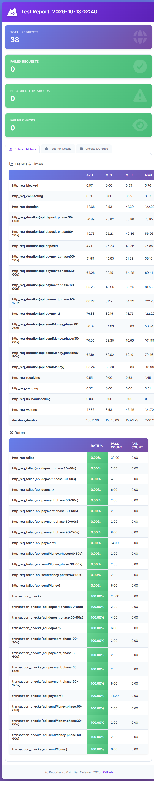

# DMoney Transaction Performance Testing

<p align="center">


</p>

## Project Overview

A k6 load test for the DMoney deposit, send money, and payment endpoints. It authenticates each role with its own credentials, runs named `constant-vus` scenarios concurrently, tags requests for per-API metrics, enforces thresholds, and writes an HTML report with `handleSummary()`.

## Technologies Used

- **k6** — concurrent transaction workload, checks, and thresholds
- **JavaScript** — scenario definitions and response validation
- **PowerShell** — environment loading and local test runner
- **HTML** — generated k6 report

## Scope

The test schedule is 120 seconds, divided into four 30-second windows. Each listed activity gets one constant VU and repeats with a 15-second think time by default. Thirteen flows run across the four windows, with a maximum of four transaction VUs active at once.

| Window | Concurrent activities |
| --- | --- |
| 00-30s | Customer 1 sends to Customer 2; Customer 2 pays Merchant 1 |
| 30-60s | Customer 2 sends to Customer 1; Agent 1 deposits to Customer 2; Customer 1 pays Merchant 1 |
| 60-90s | Agent 1 deposits to Customer 1; Agent 2 deposits to Customer 2; Customer 1 sends to Customer 2; Customer 2 pays Merchant 2 |
| 90-120s | Agent 1 pays Merchant 1; Agent 2 pays Merchant 2; Customer 1 pays Merchant 1; Customer 2 pays Merchant 2 |

Each transaction uses the sender's own JWT, the partner secret key, and phone numbers as account identifiers. Successful DMoney transaction responses are HTTP `201`, with a `trnxId` and an operation-specific success message.

## Requirements

- k6 installed and available as `k6` in PowerShell.
- A dedicated, isolated DMoney test/staging API and database. These tests write real ledger transactions; never run them against production or accounts containing real funds.
- The six test accounts must be active and match their actual roles. Agent accounts need funds for deposits/payments; customer accounts need enough funds and must remain below the deposit wallet cap; merchant accounts must be active.
- The default 15-second think time yields at most two requests per 30-second flow, keeping each customer's planned outgoing count below the default 10/day limit. Verify current usage and balances in the isolated test database before running.
- A DMoney `PARTNER_KEY`. Each account needs its own identifier, password, and account phone number.
- k6 needs internet access on the first run to load the HTML and text summary helpers.

## Configure

1. From this folder, create a local environment file:

   ```powershell
   Copy-Item .env.example .env
   ```

2. Set `BASE_URL`, each user's `*_IDENTIFIER`, `*_PASSWORD`, and `*_PHONE`. If the identifier is an email, the script logs in with that email; otherwise it logs in with the account phone number. Phone values are also used as transaction account numbers. When this folder sits beside `dmoney-transaction-api`, the runner reads `PARTNER_KEY` from that API's local `.env` if it is blank here; it never prints the key.

3. Set `DEFAULT_OTP` to the backend's configured development bypass value. The setup logs in with each user's own email/phone and password, then verifies each challenge through `/user/verify-otp?env=dev`. This test-only backend bypass must be explicitly configured and must never be enabled in production.

Credentials, OTPs, and the partner key stay in `.env`, which is ignored by Git. Do not paste them into source code, screenshots, or a public repository.

## Run

From PowerShell:

```powershell
Set-Location .\Performance-Testing
Copy-Item .env.example .env
# Edit .env with the isolated test environment values, then:
./run.ps1
```

The setup stage logs in separately as all six users, verifies each challenge using the configured development OTP bypass, and obtains each user's token before transaction scenarios begin. It does not print tokens.

The scheduled transaction workload occupies 00:00-02:00. `gracefulStop: 0s` keeps each flow within its assigned window; a request still in progress at a 30-second boundary can be interrupted. A p95 threshold failure or interrupted request should be investigated, not hidden by changing the threshold.

## Assertions and thresholds

Each transaction is checked for:

- HTTP status `201`.
- Successful operation-specific response message.
- Non-empty `trnxId`.
- Exact expected success message (`Deposit successful`, `Send money successful`, or `Payment successful`).

Overall and API-specific thresholds are configured for:

- Failed HTTP request rate below 1%.
- p(95) HTTP request duration below 1000 ms.
- Transaction assertion pass rate at least 99% (`rate>=0.99`).

Requests and checks carry `api` (`deposit`, `sendMoney`, `payment`) and `phase` tags. The tagged results let the report compare latency and failure rates by API and by time window as the workload changes. `THINK_TIME_SECONDS` is configurable; changing it changes throughput and should be noted in the report.

## Reports and screenshots

The funded 15-second-pacing run on 2026-10-13 generated [the HTML report](Reports/report.html) and [the k6 summary](Reports/k6-summary.txt). The following Playwright screenshot is from the report's Detailed Metrics view:



This run used funded test accounts. It made 26 transaction requests and all transaction checks passed (100%, 26/26); the 104 individual response assertions also passed. There were 38 HTTP requests including setup authentication and a maximum of 4 VUs. HTTP request failure was 0%, overall p(95) was 117.52 ms, and no thresholds were breached. The saved summary reports 13 iterations alongside 26 transaction checks; because the current flow function sends one transaction per iteration, verify this count on the next isolated staging run before treating it as an iteration total.

## Compare the three APIs

Use the API tags in the HTML report to record a result table after each run. Compare like-for-like runs with the same amount, account state, and think time.

| API | Transaction requests | Avg response time | p(95) | Throughput (req/s) | HTTP failed rate | Transaction check pass |
| --- | ---: | ---: | ---: | ---: | ---: | ---: |
| Deposit | 6 | 44.11 ms | 71.12 ms | 0.07 | 0% | 100% |
| Send Money | 6 | 63.24 ms | 94.10 ms | 0.07 | 0% | 100% |
| Payment | 14 | 76.33 ms | 119.45 ms | 0.07 | 0% | 100% |

Throughput is transaction request count divided by the assigned active VU duration for that API (Deposit: 3 flows x 30s; Send Money: 3 x 30s; Payment: 7 x 30s). Payment p(95) rose from 57.53 ms in the first phase to 120.72 ms in the final phase as concurrency increased, while remaining well below the 1000 ms threshold. Send Money peaked at 98.85 ms in phase 2; Deposit p(95) decreased from 73.36 ms to 55.05 ms between its active phases. Per-phase samples are small (2-8 requests), so treat these as observed variation rather than a statistically conclusive degradation trend.

| API p(95) | 00-30s | 30-60s | 60-90s | 90-120s |
| --- | ---: | ---: | ---: | ---: |
| Deposit | n/a | 73.36 ms | 55.05 ms | n/a |
| Send Money | 58.74 ms | 98.85 ms | 69.64 ms | n/a |
| Payment | 57.53 ms | 86.90 ms | 79.92 ms | 120.72 ms |

The phase-specific HTTP request failure rate was 0% and transaction-check pass rate was 100% for every API/window. The full run met the configured thresholds.

## GitHub submission

This folder is designed to be committed inside the assignment repository. Keep `.env` private; the generated HTML report, summary, and sanitized screenshot are included as assignment evidence. Review them for sensitive data before pushing.