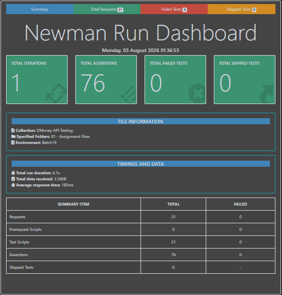

# 💰 DMoney API Testing Assignment

A comprehensive API test suite for a DMoney-style mobile financial service (MFS) transaction system, built with **Postman** and automated via **Newman**.

<p align="center">


</p>

---

## 📌 Project Overview

This repository contains the API testing assignment for a DMoney-style transaction system. It demonstrates end-to-end API test automation for a real-world mobile financial service, covering user onboarding, account activation, and core money-movement operations such as deposits, transfers, cash-outs, and merchant payments.

The project showcases:

- Design and execution of a full **Postman collection** covering positive and negative scenarios
- **Newman-based** command-line test automation with HTML reporting
- Validation of **business rules** such as commissions, service fees, and transaction status
- Structured **test case documentation** and reporting suitable for a QA portfolio

---

## 🔄 Assignment Workflow

The collection validates the complete transaction lifecycle of the DMoney system:

1. **Create 2 Customers**
2. **Create 1 Agent**
3. **Create 1 Merchant**
4. **Activate all users** via the Admin API (Customers, Agent, Merchant)
5. **System deposits 5,000 TK** to the Agent account
6. **Agent deposits 2,000 TK** to Customer 1
7. **Verify deposit commission** credited to the Agent
8. **Customer 1 sends 1,000 TK** to Customer 2
9. **Verify send-money service fee** deduction
10. **Customer 2 cashes out 500 TK** from the Agent
11. **Verify cash-out service fee** deduction
12. **Customer 2 pays the Merchant 400 TK**

Each step also includes user authentication (login/OTP verification where applicable) before the corresponding transaction request is executed.

---

## 🛠 Technologies Used

- **Postman** — API design, request collections, and test scripting
- **Newman** — CLI-based collection runner for automated execution
- **JavaScript** — Pre-request scripts and test assertions within Postman
- **Node.js** — Runtime environment for Newman and reporting tools

---

## 📁 Project Structure

```text
Assignment-2/
├── Reports/
│   └── newman-report.html
├── Screenshot/
│   └── newman_report.png
├── README.md
├── .gitignore
├── DMoney API Testing.postman_collection.json
├── Batch19.postman_environment.json
└── Dmoney_API_Test_Cases.xlsx
```

---

## ✅ Test Coverage

| Type | Count |
|------|------:|
| Positive Test Cases | 18 |
| Negative Test Cases | 12 |
| **Total** | **30** |

The suite covers:

- ✅ Positive Test Cases — valid flows across all user roles
- ✅ Negative Test Cases — invalid inputs, unauthorized actions, and edge cases
- ✅ Assertions — verifying expected responses at every step
- ✅ Business Rule Validation — commissions, service fees, and account states
- ✅ API Response Validation — status codes, payloads, and error messages

---

## 🔍 Assertions Implemented

Key validations embedded in the test scripts include:

- **Status Code** — correct HTTP response codes for each request
- **Response Message** — accurate success/error messages
- **Balance Validation** — correct debit/credit amounts across accounts
- **Commission Validation** — Agent commission calculated correctly on deposits
- **Service Fee Validation** — fees correctly applied on send-money and cash-out
- **Transaction Status** — transactions marked complete/successful as expected
- **User Activation** — Admin activation reflected correctly for each user role

---

## 🚀 Running the Collection

**1. Install dependencies**

```bash
npm install -g newman
npm install -g newman-reporter-htmlextra
```

**2. Run the collection**

```bash
newman run "DMoney API Testing.postman_collection.json" -e Batch19.postman_environment.json
```

**3. Run with HTML Extra report**

```bash
newman run "DMoney API Testing.postman_collection.json" -e Batch19.postman_environment.json -r htmlextra --reporter-htmlextra-export Reports/newman-report.html
```

---

## 📑 Test Case Document

> Detailed test cases (positive and negative) are documented in:
> **`Dmoney_API_Test_Cases.xlsx`**
>
> 🔗 [View on Google Sheets](https://docs.google.com/spreadsheets/d/1AnLLKh9ILtRol8m1Rp6B6rN4Lxss5i7v-DGK0wGdlK0/edit?gid=0#gid=0)

---

## 📊 Newman Report

| Metric | Result |
|--------|-------:|
| Requests | 21 |
| Assertions | 76 |
| Failed | 0 |

The full HTML report is generated inside the **`Reports/`** folder after each run.

**Report Preview:**



---

## 📖 API Documentation

Published Postman Documentation:

🔗 [documenter.getpostman.com/view/53084089/2sBY4TqJJs](https://documenter.getpostman.com/view/53084089/2sBY4TqJJs)

---

## 🚫 Git Ignore

The following are excluded from version control:

```text
node_modules/
Reports/
.env
```

---

## 👨‍💻 Author

**Abdullah Al Mahmud Joy**

- Full Stack SDET — Road to SDET
- M.Sc. in Computer Science & Engineering, Military Institute of Science and Technology (MIST)
- B.Sc. in Computer Science & Engineering, Bangladesh University of Business and Technology (BUBT)
- **GitHub:** [github.com/almahmudjoy](https://github.com/almahmudjoy)
- **LinkedIn:** [linkedin.com/in/abdullah-al-mahmud-joy](https://www.linkedin.com/in/abdullah-al-mahmud-joy/)
